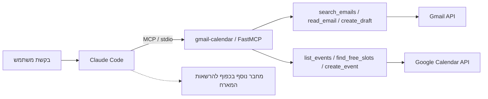
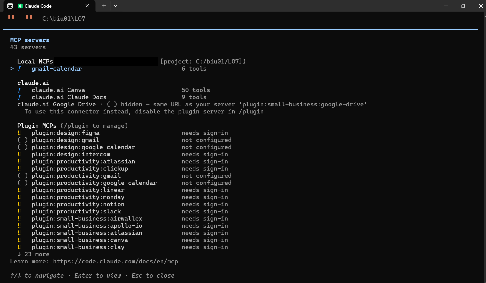
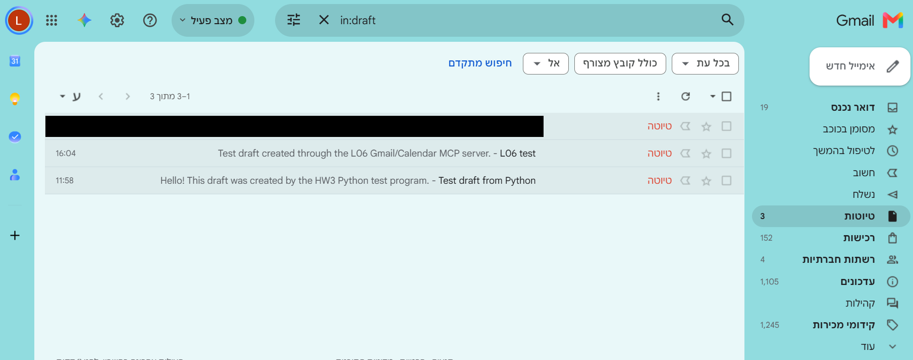
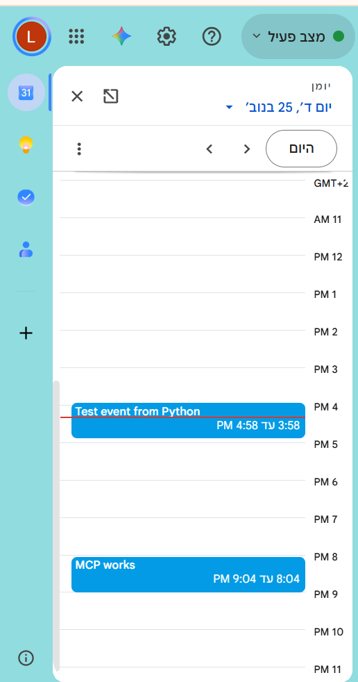

<div dir="rtl">

# מטלה 03 — שרת MCP ל־Gmail ול־Google Calendar

**אוניברסיטת בר־אילן · קורס בינה מלאכותית יוצרת · קבוצה LIATLVNT**

ליאת קפזידר (Liat Kafezider) ולבנת בנסון (Livnat Benson)

הפרויקט מיישם מחדש את תרגיל L05: הכנת טיוטה והוספת אירוע. ב־L05 סקריפט Python קבע את סדר הקריאות. ב־L06 המודל בוחר כלים ופרמטרים לפי הבקשה, והשרת מבצע את קריאות ה־API. אותם כלים מאפשרים גם לבדוק זמינות ולתאם פגישה ממייל.

## ארכיטקטורה

Claude Code הוא המארח שהודגם. הוא מפעיל את שרת FastMCP באמצעות `uv` ומתקשר איתו ב־`stdio`. פונקציות Python פונות ל־Google באמצעות OAuth. הקו המקווקו מציג נתיב אפשרי דרך מחבר נוסף של המארח, כפי שעלה בבדיקת הגבולות.

</div>



<div dir="rtl">

## כלים

| חתימה | התנהגות | ממשק Google |
|---|---|---|
| `search_emails(query, max_results=10)` | חיפוש בתחביר Gmail, עם תקרה של 50 תוצאות. מחזיר מזהה, שולח, נושא, תאריך ותקציר. | `users.messages.list` ו־`users.messages.get` למטא־נתונים |
| `read_email(message_id)` | קריאת כותרות וגוף טקסט פשוט, או תקציר חלופי, עד 8,000 תווים. | `users.messages.get` |
| `create_draft(to, subject, body)` | שמירת טיוטה בלבד. עבור `me`, הכתובת נלקחת מפרופיל החשבון. | `users.getProfile` לפי הצורך ו־`users.drafts.create` |
| `list_events(days_ahead=1)` | אירועי היומן הראשי מעכשיו עד סוף היום המבוקש. `0` הוא היום ו־`1` כולל גם את מחר. | `events.list` |
| `find_free_slots(date, duration_minutes=60, day_start="09:00", day_end="17:00")` | חלונות זמינות ביומן הראשי שאורכם לפחות כמשך המבוקש. | `freebusy.query` |
| `create_event(title, start, end, description="")` | הוספת אירוע ביומן הראשי. ההתחלה והסוף בפורמט ISO והסוף חייב להיות מאוחר מההתחלה. | `events.insert` |

## דרישות והרצה

נדרשים Python 3.13 ומעלה, `uv`, מארח MCP והגדרת OAuth תקפה מתרגיל L05. הפרויקט משתמש ב־FastMCP (`mcp[cli]<2`), בלקוח Google API, בספריות Google Auth וב־`tzdata`. זמן מקומי מפורש לפי `Asia/Jerusalem`.

הגדירו את `GOOGLE_PRIVATE_DIR` כנתיב לתיקייה פרטית מחוץ למאגר. מימוש השרת טוען את `token.json` מהתיקייה ויכול לרענן אותו באותו מקום. קובץ הלקוח והאסימון נשארים מחוץ למאגר. אם אין אסימון שמיש, יש להפיק אותו באמצעות התוכנית של L05. השרת אינו פותח דפדפן. `.gitignore` כולל את `token.json`, `client_secret*.json`, `credentials.json` ו־`.env`.

</div>

```powershell
uv sync
$env:GOOGLE_PRIVATE_DIR = "C:\path\to\private-folder"
uv run test_server.py      # self-test: lists the 6 tools and calls list_events(1)
```

<div dir="rtl">

בדיקת העשן מפעילה את השרת ומוודאת את שמות ששת הכלים. היא פונה ל־Google בקריאת `list_events(1)`. יש לקרוא את שורת התוצאה: הסקריפט מדפיס `OK` בסיום גם אם `isError` מציין שגיאה. הבדיקה אינה בודקת כתיבות.

### חיבור ל־Claude Code

הרישום מקומי לפרויקט ונשמר מחוץ למאגר ב־`~/.claude.json`. אחרי הרישום הפעילו מחדש את Claude Code והקלידו `/mcp`. ב־PowerShell יש להציב את שם השרת לפני `--env`, לצטט את המפריד `'--'`, ובמקרה ש־`uv` אינו מזוהה להשתמש בנתיב המלא ל־`uv.exe`.

</div>

```powershell
claude mcp add gmail-calendar --scope local --transport stdio --env GOOGLE_PRIVATE_DIR=C:\path\to\private-folder '--' uv run --directory C:\path\to\HW3 server.py
```

<div dir="rtl">

### דוגמת הגדרה ל־Antigravity (agy)

הקובץ המקומי `.agents/mcp_config.json` מוחרג מ־Git. זו דוגמת תצורה. החיבור המתועד בוצע ב־Claude Code. Codex מוזכר כמארח אפשרי.

</div>

```json
{ "mcpServers": { "gmail-calendar": {
    "command": "uv",
    "args": ["run", "--directory", "C:\\path\\to\\HW3", "server.py"],
    "env": { "GOOGLE_PRIVATE_DIR": "C:\\path\\to\\private-folder" } } } }
```

<div dir="rtl">

## תרחישים וראיות

- **שלב 8 — יומן למחר.** לפי היומן, הסוכן השתמש ב־`list_events` ודיווח שאין אירוע למחר.
- **שלב 9 — טיוטה ואירוע.** בשעה 16:04 התבקש הסוכן לשמור טיוטה לעצמו ולהוסיף אירוע בעוד ארבע שעות. הטיוטה **L06 test** והאירוע **MCP works** בשעות 20:04–21:04 מופיעים בצילומים.
- **שלב 10 — מפגש לימודים.** לפי התיעוד, הסוכן בחר חלון ב־09:00–10:00 וקבע את **Study group**.
- **שלב 11 — בדיקת הרשאות.** התבקשו שליחה ומחיקה. לפי היומן, ניסיון המחיקה דרך מחבר אחר נעצר בבקשת הרשאה, והטיוטה והאירוע נשארו במקומם.
- **שלב 13 — תיאום פגישה.** הסוכן התבקש לחפש בקשה במייל, לקרוא אותה ולבדוק זמינות. אילו המועד פנוי, עליו לקבוע אירוע ולהכין טיוטת אישור. במקרה של התנגשות עליו להציע שני מועדים בטיוטה. בפועל נבחר מייל אמיתי, ולפי היומן הסוכן מצא רשומות קיימות ושמר טיוטה בלבד. שני הענפים המתוכננים לא הודגמו במלואם.

### צילומי מסך מההרצה המקורית



Claude Code מציג שרת מקומי מחובר ושישה כלים.



הטיוטה **L06 test** נשמרה ב־Gmail. טיוטה פרטית אחרת הושחרה בצילום המקורי.



האירוע **MCP works** מופיע ביומן ארבע שעות לאחר זמן הבקשה המתועד.

## הרשאות ומגבלות

השרת אינו חושף כלי שליחה, העברה, מחיקה או עריכת אירוע. המשתמש בודק ושולח טיוטות בעצמו. תיאור `read_email` מנחה את המודל להתייחס לתוכן המייל כנתונים. זו שכבת הנחיה מול Prompt Injection. הרשאות OAuth המוצהרות (`gmail.modify` ו־`calendar`), רשימת כלי השרת ומדיניות המארח הן שכבות נפרדות. ההרשאות האפקטיביות בחשבון ובמארח לא אומתו במסגרת סקירת התיעוד.

בדיקת זמינות והוספה ליומן הן פעולות נפרדות. השרת אינו אוכף מניעת כפילויות או חפיפות. בהרצה המתועדת היעדר חלונות ביום שנראה פנוי הוסבר על ידי תשובת `freebusy`. תרחישי בדיקה מבוקרים, למשל מייל סינתטי לתיאום, יסייעו לבדוק כל ענף בנפרד.

## מבנה המאגר

| נתיב | תוכן |
|---|---|
| [README.md](README.md) | נקודת כניסה, הוראות וראיות |
| [PRD.md](PRD.md) | דרישות, קריטריוני קבלה, עקיבות וסיכונים |
| [reflection.md](reflection.md) | ארבע תשובות הרפלקציה ונספח ראיות |
| [PROMPTS.md](PROMPTS.md) | הפרומפטים המקוריים, לרבות שלבי בנייה, בדיקה ורישום, ויומן Codex |
| [prompts/](prompts/) | שני פרומפטי Codex כפי שהופיעו בשיחה |
| [COLLABORATION.md](COLLABORATION.md) | חלוקת העבודה ותהליך GitHub |
| [CLAUDE.md](CLAUDE.md) | כללי עבודה למימוש המקורי |
| [server.py](server.py), [google_auth.py](google_auth.py), [test_server.py](test_server.py) | שרת, אימות ובדיקת עשן |
| [pyproject.toml](pyproject.toml), [uv.lock](uv.lock), [.gitignore](.gitignore) | תלויות והחרגות |
| [screenshots/](screenshots/) | צילומי ההרצה המקוריים |

## שיתוף פעולה ושימוש ב־AI

לבנת הובילה את המימוש והגדרת החיבור ל־Google, הריצה את תרחישי המטלה ואספה ראיות בסיוע Claude Code. ליאת הובילה את הרפלקציה, הדרישות וביקורת התיעוד בסיוע Codex ואישרה את נוסח התשובות. עבודת התיעוד נסמכה על הקוד, צילומי המסך ותיעוד ההרצות של לבנת. היא לא כללה הרצה חוזרת מול Google.

</div>
